# Qanoun AI

[](https://github.com/Haytamzerr/qanounAI/actions/workflows/ci.yml)


**Ask a question about Moroccan law in Darija, Arabic or French, and get a fast answer that cites the exact articles it relies on.**

> Qanoun AI provides general legal information, not legal advice. The Arabic text published in the
> Bulletin officiel is the official version of Moroccan law; French texts are translations.

## Why

Legal texts are public but hard to use: long PDFs, legal vocabulary, two official languages, and no
help for people who think and speak in Darija. Qanoun AI closes that gap while staying honest: every
claim is tied to an article, and every citation is verified before it is shown.

## Planned features

- Questions in **Darija** (Arabic script and Arabizi), **Modern Standard Arabic** and **French**
- Retrieval-augmented answers with **verified article citations** and refusals when the law isn't covered
- **Hybrid search** (dense + sparse) with re-ranking over a curated corpus of Moroccan laws
- An open **Darija legal lexicon** mapping everyday words to legal terms
- A tool-calling **agent** for multi-step questions, and an **MCP server** exposing the legal tools
- An **evaluation suite** (retrieval, faithfulness, citation validity, Darija fidelity)
- A streaming, bilingual (RTL/LTR) web interface targeting about one second to first words

## Project layout

```text
src/qanoun/
├── ingestion/    # PDFs → clean text → one record per article
├── retrieval/    # embeddings, hybrid search, re-ranking, cache
├── understanding/ # language detection, Arabizi → Arabic script, Darija legal lexicon
├── generation/   # answers, citation checks
├── agent/        # tools and agent loop
├── mcp_server/   # MCP server
└── api/          # FastAPI service
data/             # raw / interim / processed (not committed)
eval/             # gold questions, evaluation scripts, reports
docs/             # architecture and design decisions
tests/
```

## Quick start (development)

Requires [uv](https://docs.astral.sh/uv/) and Python 3.12.

```bash
git clone https://github.com/Haytamzerr/qanounAI.git
cd qanounAI
uv sync                        # create the environment and install dependencies
uv run pre-commit install      # check code style on every commit
cp .env.example .env           # then fill in your own values
uv run pytest                  # run the fast tests
uv run pytest -m slow          # also run the tests on the real law PDFs (about 1 min)
```

## Build the legal corpus

```bash
uv run python -m qanoun.ingestion.build
```

Reads the PDFs listed in `data/sources.csv` from `data/raw/`, writes one JSON record per article to
`data/processed/articles.jsonl`, and fails if a quality check does not pass. See
[docs/corpus.md](docs/corpus.md) for the sources and how the parser reads them.

### All Moroccan laws (34,106 articles)

```bash
uv run python -m qanoun.ingestion.adala catalog     # list Adala's 5,500 documents (~10 min)
uv run python -m qanoun.ingestion.adala download    # the ~970 laws (1.3 GB)
uv run python -m qanoun.ingestion.adala_parse       # → data/processed/adala_articles.jsonl
```

Then set `QANOUN_CORPUS=full` in `.env`: search, answers and evaluations use the 5 curated laws plus
778 laws parsed from Adala (32,777 articles), in their own Qdrant collection (`articles_full`) and
vectors file. See [docs/corpus.md](docs/corpus.md#the-full-corpus-every-law-on-adala).

| Same 45 questions | 5 laws (1,329 articles) | All laws (34,513 articles, before treaties were removed) |
| --- | --- | --- |
| Correct citation in the answer | 100% | 96% |
| Citations verified | 100% | 100% |
| Held-out Arabizi, correct citation | 92% | 92% |
| Median answer time (Kaggle) | 1.5 s | 2.5 s |

## Index the articles for meaning-based search

Requires [Docker Desktop](https://www.docker.com/products/docker-desktop/) running.

```bash
docker compose up -d qdrant                 # start the vector database (Qdrant)
uv run python -m qanoun.retrieval.index     # embed the 1,329 articles with BGE-M3 and load them
```

The first run downloads the BGE-M3 model (about 2.3 GB) and embeds every article on the CPU, which
takes several minutes. The vectors are saved in `data/processed/embeddings/` and reused until an
article or the model changes. The Qdrant dashboard is at http://localhost:6333/dashboard.

Without Docker (in a cloud notebook, or on a PC short of memory), set `QANOUN_QDRANT_URL=data/qdrant`:
Qdrant then runs inside Python and saves to that folder.

### On a laptop with 8 GB of RAM

The full model (2.3 GB + torch) may not fit. Compute the article vectors once on a machine that can
(a free Kaggle GPU notebook works), copy the `.npz` file into `data/processed/embeddings/`, then
use the 8-bit version of the same model (568 MB, onnxruntime only) for questions. In `.env`:

```bash
QANOUN_EMBEDDING_BACKEND=onnx      # questions: 8-bit BGE-M3 (Xenova/bge-m3)
QANOUN_QDRANT_URL=data/qdrant      # Qdrant as a folder, no Docker needed
```

```bash
uv run python -m qanoun.retrieval.index --backend sentence-transformers   # loads the saved vectors, no model
uv run python -m qanoun.generation.ask "chhal dyal lconji 3ndi f l3am?"
uv run python -m qanoun.generation.ask "mol dar ma bghach ysle7 lma li kay9tar" --analysis
```

With the full corpus (34,106 articles), skip Qdrant on the PC: add `QANOUN_VECTOR_STORE=numpy` to
`.env` and the app searches the vectors file from Kaggle directly in memory (~4 ms per question,
no index step; decision 66).

Long articles (lists of offences, of conditions…) also get one vector per passage, so a detail deep
inside them is found (decision 67). Compute them once, after the article vectors:

```bash
uv run python -m qanoun.retrieval.passages   # 2,872 passages of 857 long articles
```

Measured cost of the 8-bit model for questions: none on Arabic, French or Arabizi; one of the four
Darija questions in Arabic script (decision 55).

## Evaluate search

```bash
uv run python -m qanoun.retrieval.evaluate --method bm25 dense hybrid
```

Scores each search method on 45 test questions (`eval/retrieval_set.jsonl`) in Arabic, French and Darija, writes one report per method to `eval/reports/`, and a comparison table when several methods run.

| Method | Hit@5 | Arabic | French | Darija (Arabic script) | Arabizi |
| --- | --- | --- | --- | --- | --- |
| BM25 keywords (baseline) | 47% | 78% | 11% | 25% | 11% |
| **Dense (BGE-M3 + Qdrant)** | **82%** | **100%** | **100%** | **75%** | 22% |
| Hybrid (BM25 + dense, RRF) | 73% | 96% | 89% | 25% | 22% |
| **Dense + Darija lexicon** | **96%** | **100%** | **100%** | **100%** | **78%** |

Meaning-based search finds the right article for every Arabic and French question, including French
questions answered by Arabic-only laws. Plain RRF fusion *lowers* the score: BM25 can't match across
languages, so it pushes wrong articles into the fused list. Arabizi (Darija in Latin letters) is the
open problem: the next step converts it to Arabic script before searching.

### Darija: understanding the question first

Before searching, each question goes through `qanoun.understanding`: language detection (rules,
45/45 correct) and an open [Darija → legal-Arabic lexicon](data/lexicon/darija_legal.csv) that adds
the law's words to everyday ones ("tredouni mn lkhedma" → "الفصل من الشغل"). Measured part by part
with the real model (dense search, hit@5):

| Dense + … | All (45 q.) | Darija, Arabic script | Arabizi, development (9 q.) | Arabizi, held-out (12 q.) |
| --- | --- | --- | --- | --- |
| nothing | 82% | 75% | 22% | 0% |
| Arabizi → Arabic script | 80% | 75% | 11% | 0% |
| **lexicon (default)** | **96%** | **100%** | **78%** | **50%** |
| both | 87% | 100% | 33% | 42% |

With the language model restating Arabizi questions in formal legal Arabic before the search
(`+rewrite`), the held-out Arabizi score goes from **50% to 92%** (MRR 0.32 → 0.79), development
Arabizi from 78% to 89%. It is on by default, for Arabizi only.

Arabic and French stay at 100% in every row. The held-out questions
([eval/darija_holdout.jsonl](eval/darija_holdout.jsonl)) were written by a native speaker who never
saw the lexicon and were scored before any change: on its own, the model finds none of them. The
Arabizi → Arabic-script conversion lowers the scores (its approximate spellings add noise), so it
is off by default.

## Ask a question

Put a Gemini API key (free at https://aistudio.google.com/apikey) in `.env` as `QANOUN_LLM_API_KEY`,
then:

```bash
uv run python -m qanoun.generation.llm --list-models     # check the key, see the models
uv run python -m qanoun.generation.ask "chhal dyal lconji 3ndi f l3am?"
uv run python -m qanoun.generation.ask "…" --retriever bm25   # without the embedding model
```

The answer is written only from the retrieved articles, in the language and script of the question,
with numbered citations. Every citation is checked before it is shown (no unknown source, no article
number that isn't in the sources); a failed check gets one retry, then a visible warning.

### Answer quality

Full assistant (dense search + Darija lexicon + LLM restatement of Arabizi + section expansion →
Gemini → citation check), measured with `python -m qanoun.generation.evaluate` on Kaggle
(2026-10-14):

| Question set | Right article retrieved | Answered | Cites the right article | Citation check passed | Refused although the answer was in the sources | Median time |
| --- | --- | --- | --- | --- | --- | --- |
| 45 development questions (Arabic, French, Darija) | 100% | 100% | **100%** | **100%** | **0%** | 1.5 s |
| **12 held-out Arabizi questions** (native speaker, never seen) | 92% | 100% | **92%** | **100%** | **0%** | 4.7 s |

Before the Arabizi restatement, the held-out set scored 50% on every one of these lines. The
development set helped build the lexicon, so it flatters the system; the held-out set is the
honest number.

## Web app

```bash
uv run python -m qanoun.api        # open http://127.0.0.1:8000 (API docs: /docs)
```

| Home | Answer with citations | Official article |
| --- | --- | --- |
| 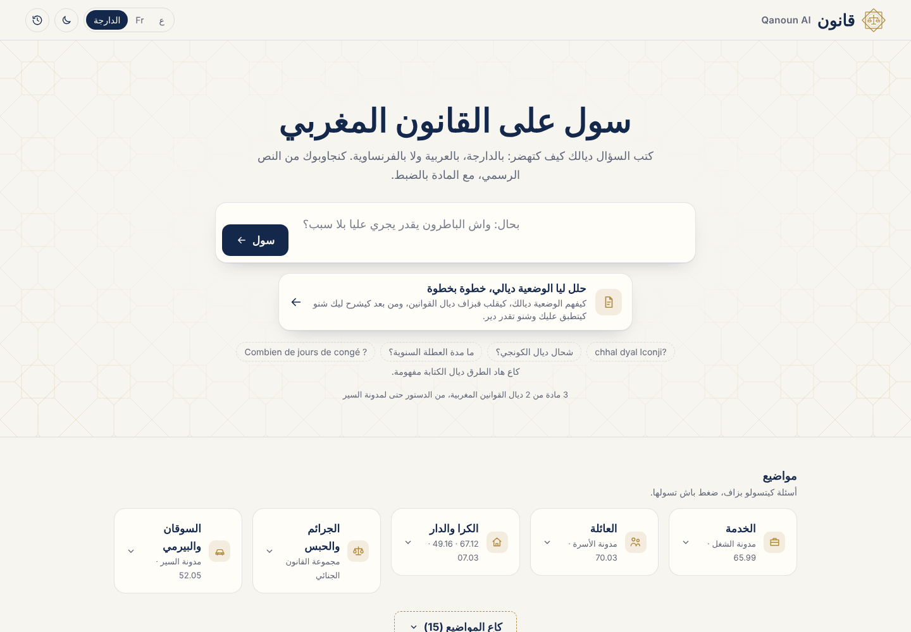 | 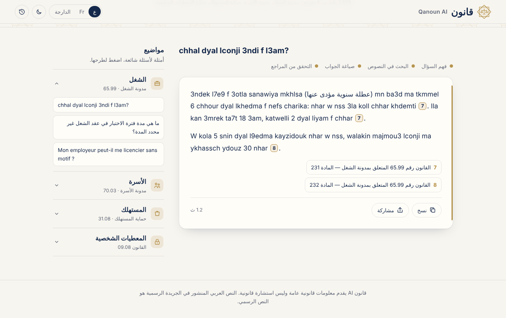 | 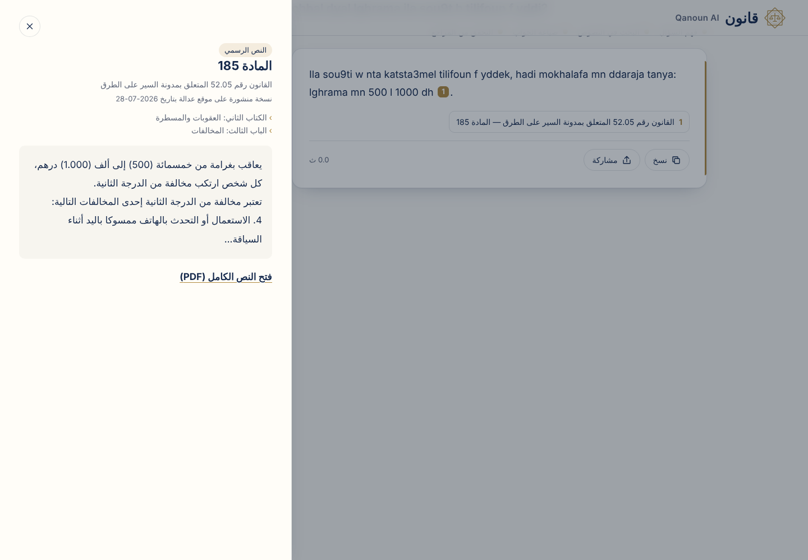 |

Two ways to ask (decision 75): **quick answer**, or **analyse my situation**: the assistant plans
the research (2–4 searches in the law's own words), then answers in sections — your situation ·
what the law says · what it means for you · what you can do · what is missing. Follow-up questions
keep the conversation (decision 76).

| Analysis | Follow-up |
| --- | --- |
| 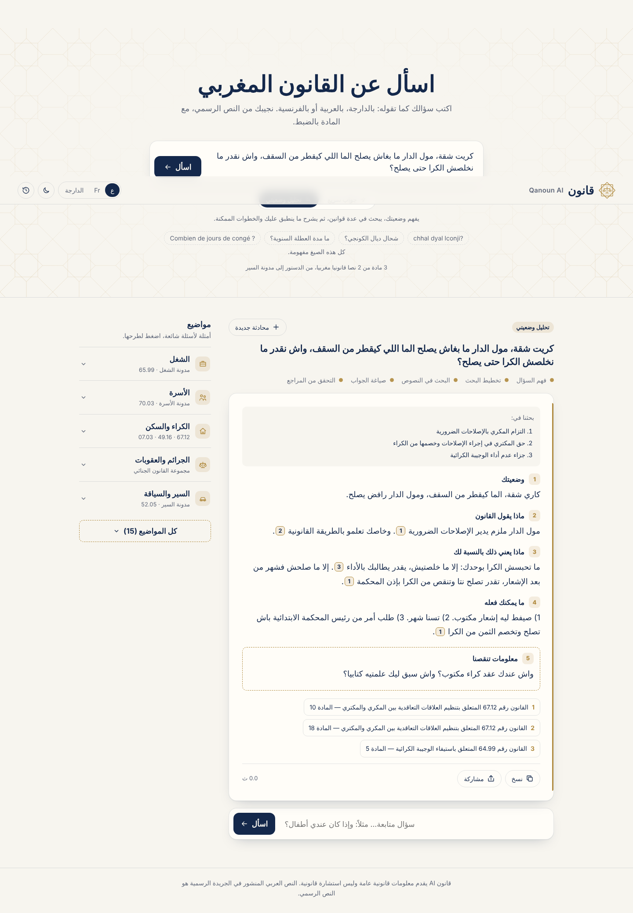 | 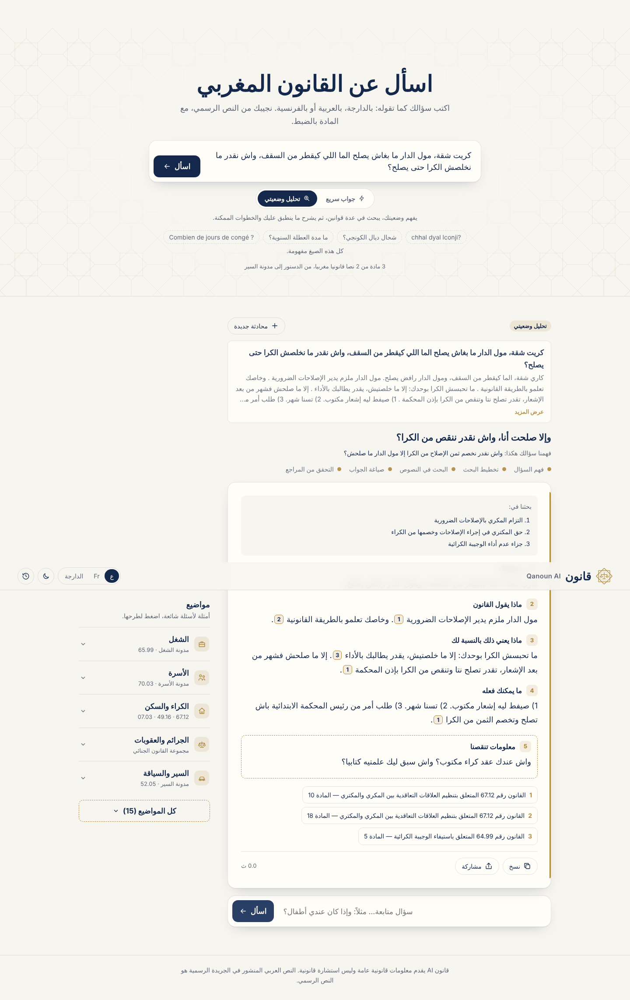 |

The home page shows five themes; "all themes" opens the fifteen (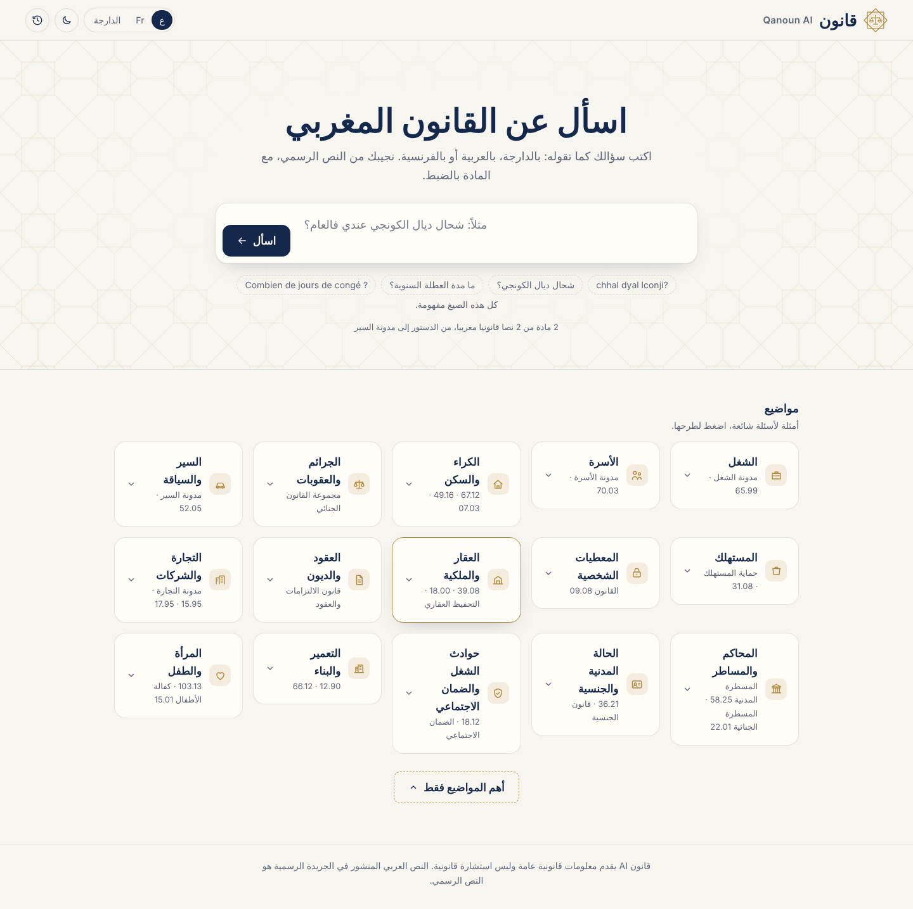).

**Analyse my situation** opens a page of its own: six short steps while a case file writes itself beside them, then a five-part analysis with a checklist of steps and the missing facts as one-tap questions (decision 81).

| 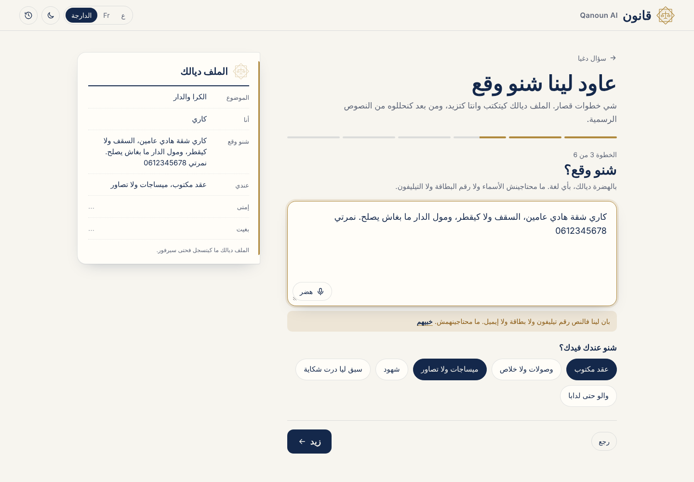 | 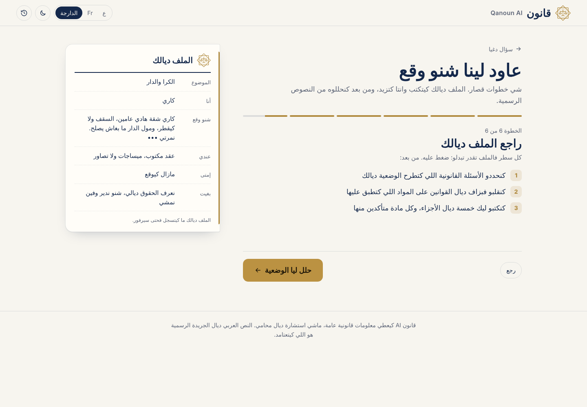 | 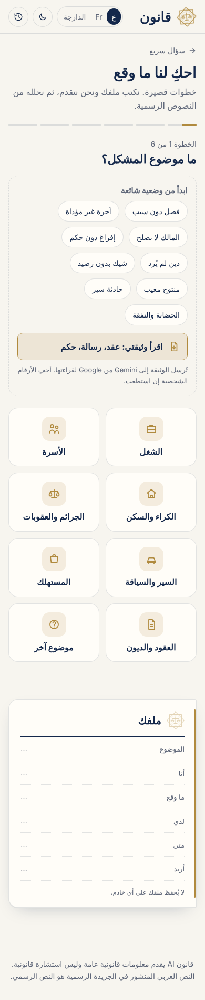 |
| --- | --- | --- |
| 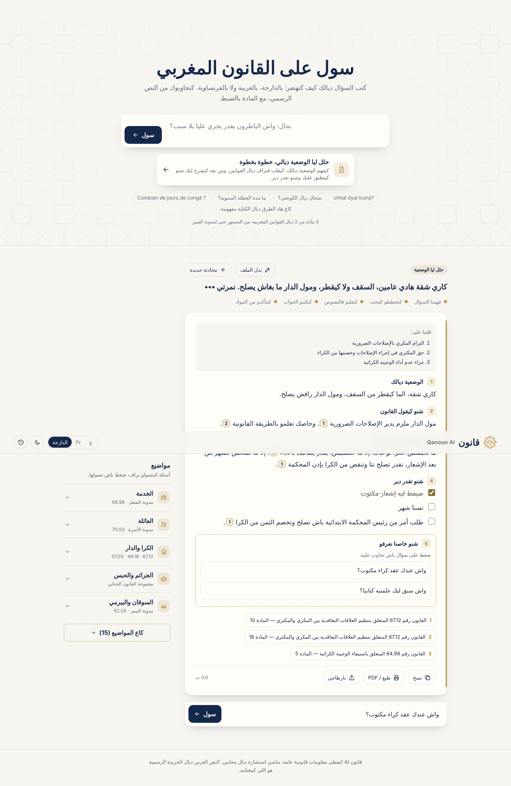 | | |

Under the analysis, three tools turn it into action (decisions 82–86): **legal deadlines** checked against the article's own words, with the last day and a calendar reminder; **calculators** (dismissal indemnity, damages, annual leave, rent increase) whose rates come from the articles and whose arithmetic is tested code; and **letters** (notice, complaint, request) drafted from the cited articles only, with blanks for what we don't know, as Word or print. The file can also start from a ready-made situation or from the person's own contract or letter. Every technique is explained in [docs/learning/situation-tools.md](docs/learning/situation-tools.md).

| 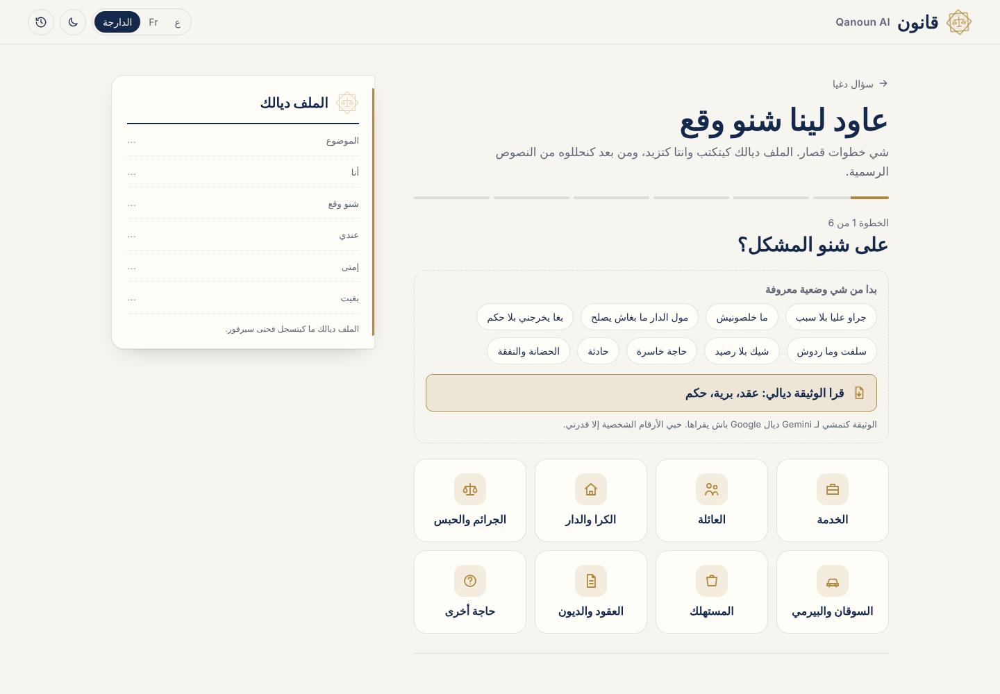 | 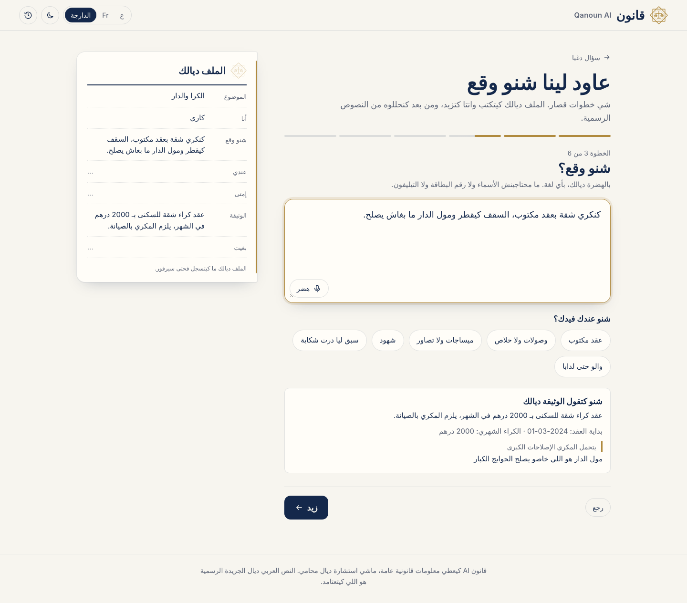 | 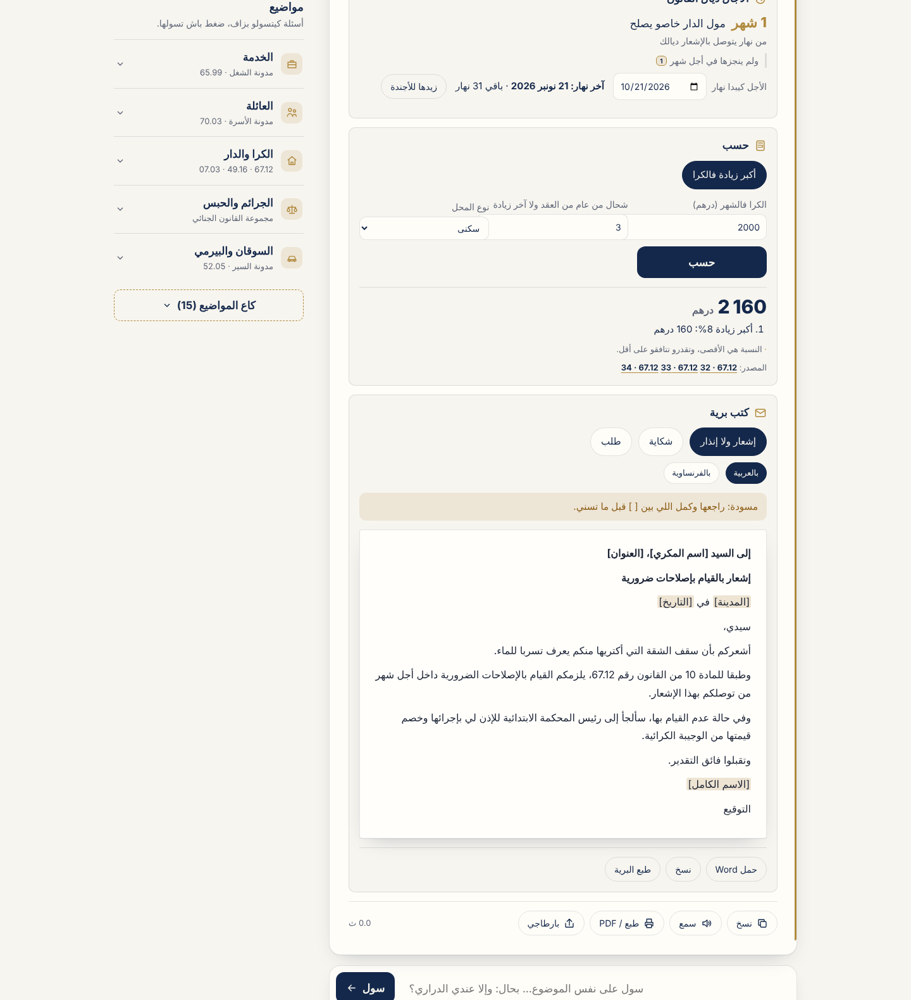 |
| --- | --- | --- |
Answers can also correct a wrong premise ("l'article 400 du Code pénal…" is looked up directly),
ask a short question back when the question is too vague, and the article panel says how recent
the text is.

Ask in Darija (Arabic letters or Arabizi), Arabic or French; the steps show live; every [n] opens the
official article; copy or share the answer with its sources; interface in Arabic, French or Darija;
light and dark themes; history kept on the device. Design brief: [docs/design.md](docs/design.md).

`POST /ask` returns a checked answer with the cited articles in full; `POST /ask/stream` sends the
progress steps first (Server-Sent Events); `GET /articles/{id}` opens a citation; `GET /health`.

## Roadmap

- [x] Phase 0: project setup
- [x] Phase 1: legal corpus: 1,329 hand-checked articles from 5 texts: personal data (09-08, Arabic + French), Labour Code (65.99, July 2026), Family Code (70.03), Consumer Protection (31.08); then **every law on Adala: 34,106 articles from 783 laws**
- [x] Phase 2: indexing and retrieval (dense BGE-M3 + Qdrant, Darija lexicon, section expansion)
- [x] Phase 3: grounded answers with checked citations (Gemini)
- [ ] Phase 4: evaluation framework
- [ ] Phase 5: agent and MCP server
- [ ] Phase 6: API, interface, Docker, deployment
- [ ] Phase 7: safety
- [ ] Phase 8: demo and write-up

## License

MIT
